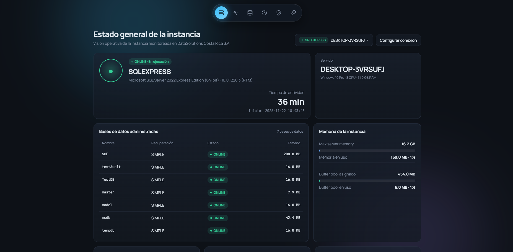
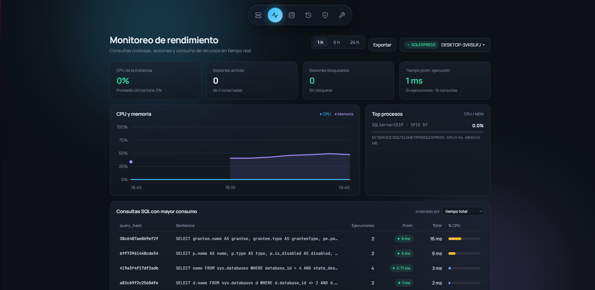
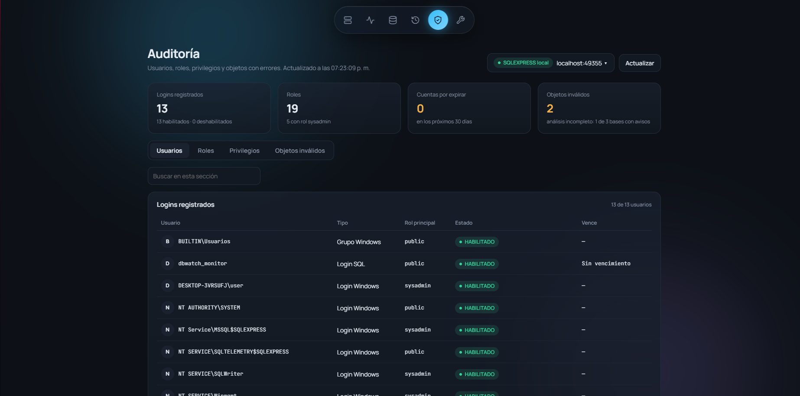
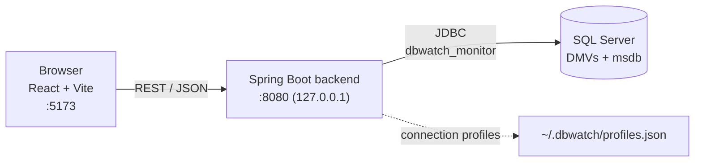

# DBWatch — SQL Server Instance Monitor

A web-based monitoring and preventive-maintenance tool for Microsoft SQL Server. It reads the instance's own administrative views (DMVs) and `msdb` directly, so there is **nothing to install on the server**: no agents, no extra tables, no migrations.


Built as the capstone project for National University of Costa Rica's **Database Administration** course (EIF402), with a focus on how a DBA would actually monitor an instance: least-privilege access, safe write operations, and honest reporting when data can't be read.


  
  
  

---

## Table of contents

- [Features](#features)
- [Engineering highlights](#engineering-highlights)
- [Architecture](#architecture)
- [Tech stack](#tech-stack)
- [Getting started](#getting-started)
- [Permission model](#permission-model)
- [Configuration](#configuration)
- [API overview](#api-overview)
- [Testing](#testing)
- [Project structure](#project-structure)
- [Troubleshooting](#troubleshooting)
- [Security considerations](#security-considerations)
- [Known limitations and ideas](#known-limitations-and-ideas)
- [Author](#author)

---

## Features

DBWatch is organized in six modules. All of them run on a single monitoring login (`dbwatch_monitor`) that is neither `sysadmin` nor `db_owner`.

> The UI is currently in Spanish. English equivalents are given in parentheses.

| # | Module | What it shows / does | Main sources |
|---|---|---|---|
| 1 | **Instance Status** (*Estado de la instancia*) | Version, edition, uptime, CPU and memory, active sessions, database list with size and recovery model | `SERVERPROPERTY`, `sys.dm_os_sys_info`, `sys.dm_os_process_memory`, `sys.databases`, `sys.master_files` |
| 2 | **Performance** (*Rendimiento*) | CPU/memory charts (1 h / 6 h / 24 h), costly queries, active processes, blocking chains, optional *terminate blocking session*, export to **PDF / XLSX / CSV** | `sys.dm_os_ring_buffers`, `sys.dm_exec_*`, `sys.dm_tran_locks` |
| 3 | **Storage** (*Almacenamiento*) | Data/log files and growth, log usage, 10 largest objects, 6-month monthly growth trend | `sys.database_files`, `sys.dm_db_log_space_usage`, `sys.dm_db_partition_stats`, `msdb.dbo.backupset` |
| 4 | **Backup & Recovery** (*Respaldo y recuperación*) | Risk banner, last successful backup, 14-day success rate, history, retention policy, failed backups from the error log, **Run FULL now** button | `msdb.dbo.backupset`, `msdb.dbo.backupmediafamily`, `xp_readerrorlog` |
| 5 | **Audit** (*Auditoría*) | Logins (password policy / expiration, weak-login flags), server roles and members, permissions, **invalid objects** per database | `sys.server_principals`, `sys.sql_logins`, `sys.server_permissions`, `sys.sql_expression_dependencies` |
| 6 | **Preventive Maintenance** (*Mantenimiento preventivo*) | Stale statistics, broken views/procedures/functions, **Update statistics** and **Fix / recompile** actions with confirmation and result verification | `sys.stats`, `sys.dm_db_stats_properties`, `sys.sql_modules`, `sys.dm_sql_referenced_entities` |

---

## Engineering highlights

- **Zero footprint on the monitored server.** All data comes from DMVs and `msdb`. The only state the app keeps is `~/.dbwatch/profiles.json` (connection profiles).
- **Least privilege by design.** The monitoring login gets exactly the permissions each module needs. Write capabilities are limited to `db_backupoperator` (FULL backups), `ALTER` on objects you explicitly authorize (maintenance) and, optionally, `ALTER ANY CONNECTION` (terminate blocking sessions). The app never grants permissions to itself.
- **Idempotent setup scripts.** Every SQL script can be re-run safely; existing logins keep their password, orphaned users are re-mapped automatically.
- **Verified write operations.** After *Update statistics*, the API compares per-statistic dates before and after the command and returns one of three explicit states — `verified`, `unverified` or `failed` — instead of a blind "success". Writes are never retried automatically, and a timeout is not reported as a rollback.
- **No false "all clear".** Errors are handled per section. If a database can't be read (missing permission, restricted mode), the module shows a warning for that database instead of presenting an empty list as "no problems".
- **Race-free database switching.** Changing the selected database cancels pending reads and discards stale responses, so an old answer never overwrites the latest selection.
- **Dependency-free metrics history.** CPU/memory come from SQL Server ring buffers (charts work immediately); the backend additionally samples metrics in memory (every ≥30 s, up to 25 h) for the longer ranges.

---

## Architecture



---

## Tech stack

| Layer | Technology |
|---|---|
| Frontend | React, Vite, ESLint |
| Backend | Java (21 or 25), Spring Boot, Maven, Microsoft JDBC Driver for SQL Server |
| Testing | JUnit, Mockito (started as an agent via Surefire) |
| Database | Microsoft SQL Server 2017+ (Express, Developer or Docker image) |

---

## Getting started

### Prerequisites

- **JDK 25** (original setup) or **JDK 21** — see the note in step 4
- **Node.js 22.12+** (Node 24 LTS works) and npm
- **SQL Server 2017 or later** (Express or Developer; the queries use `sys.dm_os_host_info`, which doesn't exist in older versions)
- **SSMS** or **Azure Data Studio** to run the setup scripts
- A **sysadmin** session on the instance to run the scripts (e.g. Windows authentication on your own machine)

### 1. Clone

```bash
git clone https://github.com/RubenJisan/sql-server-instance-monitor.git
cd sql-server-instance-monitor
```

### 2. Prepare SQL Server

The Java backend connects over TCP/IP with SQL Server authentication.

<details>
<summary><strong>Option A — Local SQL Server (Express / Developer)</strong></summary>

1. Open **SQL Server Configuration Manager**.
2. *SQL Server Network Configuration* → *Protocols for SQLEXPRESS* → **TCP/IP** → *Enabled*.
3. TCP/IP properties → *IP Addresses* tab → **IPAll**: leave *TCP Dynamic Ports* **empty** and set *TCP Port* to `1433`.
4. Restart the service (PowerShell as administrator):
   ```powershell
   Restart-Service 'MSSQL$SQLEXPRESS'        # default instance: Restart-Service MSSQLSERVER
   Test-NetConnection localhost -Port 1433   # expect TcpTestSucceeded : True
   ```
5. Check that mixed-mode authentication is on:
   ```sql
   SELECT SERVERPROPERTY('IsIntegratedSecurityOnly') AS windows_only;  -- 0 = OK, 1 = enable mixed mode and restart
   ```

If you prefer not to fix the port, find the one in use with `EXEC sys.xp_readerrorlog 0, 1, N'listening on';` and enter it in the app.

</details>

<details>
<summary><strong>Option B — SQL Server in Docker</strong></summary>

```powershell
docker run -e "ACCEPT_EULA=Y" -e "MSSQL_SA_PASSWORD=<STRONG_SA_PASSWORD>" -p 1433:1433 --name sqlserver -d mcr.microsoft.com/mssql/server:2022-latest
```

Connect from SSMS with `localhost,1433` and the `sa` user to run the scripts. In the app use server `localhost`, empty instance, port `1433`, and enable *Trust server certificate*. Mixed mode is already on; the default backup folder is `/var/opt/mssql/data`.

</details>

### 3. Run the SQL setup scripts

Scripts live in [`sql/`](sql/) and are **idempotent** — safe to run more than once. Run them in order from a sysadmin session:

| Order | Script | Purpose |
|---|---|---|
| 1 | [`01_create_monitor_login.sql`](sql/01_create_monitor_login.sql) | Creates `dbwatch_monitor` and grants server-level permissions. **Replace `<STRONG_PASSWORD>` first.** |
| 2 | [`02_demo_databases.sql`](sql/02_demo_databases.sql) | *(Optional)* Demo databases to see every module working with data |
| 3 | [`03_grant_database_access.sql`](sql/03_grant_database_access.sql) | Creates/re-maps the user and grants permissions in **every** database. Re-run after creating or restoring a database |
| 4 | [`04_grant_maintenance_permissions.sql`](sql/04_grant_maintenance_permissions.sql) | `ALTER` on the objects of the database you want to maintain (module 6). Set `@Database` first |
| 5 | [`05_verify_permissions.sql`](sql/05_verify_permissions.sql) | Verifies effective permissions *as* `dbwatch_monitor` |
| — | [`06_backup_template_and_cleanup.sql`](sql/06_backup_template_and_cleanup.sql) | Manual FULL/DIFF/LOG backup template and cleanup helpers |
| — | [`99_drop_demo_databases.sql`](sql/99_drop_demo_databases.sql) | Removes the demo databases and their backup history |

> **When to re-run what:** new/restored database → script 03 · maintain a database → 03 then 04 · new objects in a maintained database → 04 · changed the login password → 01 with `@ResetPassword = 1` · upgraded to SQL Server 2022+ → 01 · hide the *terminate session* button → 01 with `@AllowKill = 0` · something missing in a module → 05.

### 4. Start the backend and frontend

Open two terminals from the repository root.

```powershell
# Terminal 1 — backend (http://localhost:8080)
cd backend
.\mvnw.cmd spring-boot:run
# With JDK 21:  .\mvnw.cmd "-Djava.version=21" spring-boot:run
```

```powershell
# Terminal 2 — frontend (http://localhost:5173)
cd frontend
npm ci
npm run dev
```

Open <http://localhost:5173>.

### 5. Connect the app to your instance

In *Instance Status* → **Configure connection** (*Configurar conexión*):

| Field | Value |
|---|---|
| Name | Anything, e.g. `Local` |
| Server | `localhost` (letters, digits, `.`, `_`, `-` only — **not** `localhost\SQLEXPRESS`) |
| Instance | `SQLEXPRESS`, or empty for the default instance |
| Port | `1433` (or your port). **If a port is set, the instance name is ignored** |
| Authentication | SQL Server |
| User / Password | `dbwatch_monitor` / the password from script 01 |
| Encrypt connection | On |
| Trust server certificate | On (local self-signed certificate) |
| Refresh interval | Your choice (minimum 5 s) |

Click **Test connection**, then **Save**. The profile is stored in `~/.dbwatch/profiles.json` and re-activated automatically when the backend restarts. Make sure a connection is marked **active**; if saving doesn't activate it, use *Connect*. All modules share that one active connection.

<details>
<summary><strong>Windows integrated authentication</strong></summary>

The steps above use SQL Server authentication and need no native library. If you choose integrated Windows authentication, the code uses `integratedSecurity=true`, which requires the `mssql-jdbc_auth` DLL matching your driver version and JVM architecture to be available to the Java process (via `PATH` or `java.library.path`). Without it, Windows authentication can fail even if SSMS connects fine. See the [JDBC connection URL docs](https://learn.microsoft.com/en-us/sql/connect/jdbc/building-the-connection-url).

</details>

### 6. Try it with demo data

If you ran script 02, followed by 03 and then 04 (with `@Database = N'DbWatchMaintenanceDemo'`), the [manual testing guide](docs/testing-guide.md) walks through each module: generating CPU load, creating a blocking chain, backup scenarios with expected values, an invalid-object audit, and the maintenance fix flow.

---

## Permission model

| Permission | Scope | Used by |
|---|---|---|
| `VIEW SERVER STATE` | Server | Modules 1–3 |
| `VIEW ANY DEFINITION` | Server | Modules 1, 5 |
| `CONNECT ANY DATABASE` | Server | Module 3 |
| `VIEW SERVER PERFORMANCE STATE`, `VIEW ANY ERROR LOG` | Server (SQL Server 2022+) | Modules 2, 4 |
| `ALTER ANY CONNECTION` | Server — **optional** | *Terminate session* button (module 2) |
| `SELECT` on `msdb.dbo.backupset` / `backupmediafamily` | `msdb` | Modules 3, 4 |
| `EXECUTE` on `xp_readerrorlog` | `master` | Module 4 (failed backups) |
| `VIEW DEFINITION` + `SELECT` on `sys.sql_expression_dependencies` | Each database | Modules 5, 6 |
| `db_backupoperator` | Each database | *Run FULL now* (module 4) |
| `ALTER` (+ optional `SELECT`) on user objects | Maintained database | Module 6 |

`dbwatch_monitor` is deliberately **not** a member of `sysadmin` or `db_owner`.

---

## Configuration

Backend settings live in `backend/src/main/resources/application.properties`:

| Property | Default | Description |
|---|---|---|
| `server.address` | `127.0.0.1` | Backend only accepts local connections |
| `server.port` | `8080` | Backend port |
| `app.allowedOrigin` | `http://localhost:5173` | CORS origin; must match the exact frontend URL (adjust if Vite picks another port) |
| `app.configDir` | `${user.home}/.dbwatch` | Folder where `profiles.json` is stored |
| `app.maintenance.timeoutSeconds` | `300` | Timeout for each maintenance action (other modules are unaffected) |

The frontend calls `http://localhost:8080/api`. The Maintenance screen can override this with the `VITE_API_URL` environment variable.

---

## API overview

| Module | Endpoints |
|---|---|
| Instance | `GET /api/instance/overview`, `GET /api/connections` |
| Performance | `GET /api/performance/overview?range=1h\|6h\|24h`, `POST /api/performance/sessions/{id}/kill`, `GET /api/performance/export?format=pdf\|xlsx\|csv&range=1h&sections=queries,sessions,blocking,chart` |
| Storage | `GET /api/storage/overview?database=` |
| Backup | `GET /api/backups/overview?database=`, `POST /api/backups/full?database=` |
| Audit | `GET /api/audit/overview` |
| Maintenance | `GET /api/maintenance/overview?database=`, `POST /api/maintenance/statistics`, `POST /api/maintenance/refresh` |

<details>
<summary><strong>Maintenance result semantics</strong></summary>

After a confirmed *Update statistics*, per-statistic dates are read before and after the command (without comparing against the backend clock):

- `status: verified`, `ok: true` — statistics identity and count are unchanged and every date advanced (a date that was missing and is now present also counts).
- `status: unverified`, `ok: false` — the command finished without a SQL error, but dates are missing, one didn't advance, the list changed, or the follow-up query failed. The UI shows a yellow "unverifiable result" notice; it is neither a confirmed success nor a proven SQL failure.
- `status: failed`, `ok: false` — an execution error or a pre-read error occurred. A timeout does not prove that an already-started operation was rolled back.

API clients should check `status` in addition to `ok`. A statistics object may legitimately have no date or counter (no rows to build statistics from, or limited visibility), and a modification counter of `0` is normal right after an update. The module shows *"No date available"* instead of inventing a value, and displays the **oldest** available date — if some are missing, that date doesn't represent all statistics.

*Fix / recompile* refreshes metadata and checks dependencies; it does not run procedure bodies, restore missing tables/columns, or take backups.

</details>

---

## Testing

```powershell
# Backend
cd backend
.\mvnw.cmd test                              # JDK 25
.\mvnw.cmd "-Djava.version=21" test          # JDK 21

# Frontend
cd frontend
npm run build
npx eslint src/pages/maintenance/Maintenance.jsx
```

The backend suite covers business logic, SQL/timeout handling and the maintenance module's routes, plus the Spring context test. Mockito is started as a Java agent through Surefire to avoid dynamic agent attachment warnings on recent JDKs.

Automated tests verify the code and route integration; they don't replace the end-to-end walkthrough against a real SQL Server in the [testing guide](docs/testing-guide.md).

---

## Project structure

```
sql-server-instance-monitor/
├── backend/
│   └── src/main/
│       ├── java/grupo1/backend/...
│       └── resources/application.properties
├── frontend/
│   └── src/pages/<module>/...
├── sql/
└── docs/
    └── testing-guide.md
```

---

## Troubleshooting

<details>
<summary><strong>Common problems and fixes</strong></summary>

| Symptom | Cause and fix |
|---|---|
| `.jsx` extension error | Use `npm run dev`; don't run a React component with Node directly |
| "No active connection" (*Sin conexión activa*) | Configure and connect a profile from *Instance Status* |
| Port 1433 closed (`TcpTestSucceeded : False`) | Check the service, TCP/IP and the actual port — it isn't fixed by changing React code |
| App can't connect by instance name | With an empty port the instance name is used (needs *SQL Server Browser*, UDP 1434). Simpler: fix the port (step 2) and enter it |
| Unsure of the instance name | `SELECT SERVERPROPERTY('ServerName'), SERVERPROPERTY('InstanceName'), SERVERPROPERTY('ProductVersion');` — a `NULL` `InstanceName` is the default instance: leave the field empty |
| Login rejected | Check mixed mode, that the login is enabled and the password is current (script 01 with `@ResetPassword = 1`) |
| CORS error in the browser | `app.allowedOrigin` must equal the exact frontend URL |
| Modules 1–3 show "could not obtain…" warnings | Missing `VIEW SERVER STATE` / `VIEW ANY DEFINITION` / `CONNECT ANY DATABASE` → script 01 |
| Terminate session fails | Missing `ALTER ANY CONNECTION` → script 01 with `@AllowKill = 1`. Only sessions that are blocking others can be terminated |
| Backup: red banner "could not read error log" | Missing `EXECUTE` on `xp_readerrorlog` (script 03) or `VIEW ANY ERROR LOG` on 2022+ (script 01) |
| Backup: *Run FULL now* fails on a database | Missing `db_backupoperator` (script 03), folder doesn't exist or isn't writable by the SQL Server **service account**, or the database is read-only |
| Audit: "could not analyze database X" | Missing user or `VIEW DEFINITION` in that database → script 03 |
| Maintenance: "VIEW DEFINITION required" / missing `ALTER` | Scripts 03 and 04 on the selected database; don't add `sysadmin` as a general fix |
| Maintenance: no date / counter unavailable | May be limited visibility or no statistical data; not necessarily a failed update |
| Maintenance: "has no existing statistics" | A table without statistics has nothing to update; the action never creates new ones |
| Maintenance: empty object list | Distinguish "no findings" from "incomplete analysis" — read the warnings |
| Script 03 prints `ERROR <db>` | The SQL Server message follows on the same line; typical causes are restricted-mode databases or insufficient rights in the executing session |

References: [UPDATE STATISTICS](https://learn.microsoft.com/en-us/sql/t-sql/statements/update-statistics-transact-sql) · [sp_refreshsqlmodule](https://learn.microsoft.com/en-us/sql/relational-databases/system-stored-procedures/sp-refreshsqlmodule-transact-sql) · [dm_db_stats_properties](https://learn.microsoft.com/en-us/sql/relational-databases/system-dynamic-management-objects/sys-dm-db-stats-properties-transact-sql) · [BACKUP](https://learn.microsoft.com/en-us/sql/t-sql/statements/backup-transact-sql) · [sp_readerrorlog](https://learn.microsoft.com/en-us/sql/relational-databases/system-stored-procedures/sp-readerrorlog-transact-sql)

</details>

---

## Security considerations

- `~/.dbwatch/profiles.json` may contain **plain-text passwords**. Never commit it, attach it, or include it in shared backups or screenshots.
- Never put real passwords in the scripts or this README; `<STRONG_PASSWORD>` is a placeholder.
- The backend listens on `127.0.0.1` only and has **no authentication of its own**: anyone with access to that machine can use the app with the permissions of the configured login. Don't expose it on a network as-is.
- Scripts that create demo objects (e.g. the intentionally weak `dbwatch_demo_debil` login in the testing guide) are for local test instances only.

---

## Known limitations and ideas

- **FULL backups from the UI are capped by a 30 s query timeout** (`QUERY_TIMEOUT_SECONDS` in `ActiveConnection`). For large databases use the SSMS template in [`sql/06_backup_template_and_cleanup.sql`](sql/06_backup_template_and_cleanup.sql).
- Performance history for the 6 h / 24 h ranges is kept in memory and is lost when the backend restarts.
- The UI is in Spanish and some screens hard-code the API URL; centralizing it (`VITE_API_URL` everywhere) and adding i18n are natural next steps.
- Possible extensions: authentication for the backend API, persisting metrics history, alerting thresholds, and a Docker Compose file to start the full stack.

---

## Authors

**Rubén Jiménez** — Software Solutions Developer
[GitHub](https://github.com/RubenJisan) · [LinkedIn](https://www.linkedin.com/in/rubenjisan>)

**Paulo Zamora**

**Pablo Campos**

**Naara Menjivar**

**Ignacio Bolaños**

## License

MIT License

Copyright (c) 2026 RubenJisan

Permission is hereby granted, free of charge, to any person obtaining a copy
of this software and associated documentation files (the "Software"), to deal
in the Software without restriction, including without limitation the rights
to use, copy, modify, merge, publish, distribute, sublicense, and/or sell
copies of the Software, and to permit persons to whom the Software is
furnished to do so, subject to the following conditions:

The above copyright notice and this permission notice shall be included in all
copies or substantial portions of the Software.

THE SOFTWARE IS PROVIDED "AS IS", WITHOUT WARRANTY OF ANY KIND, EXPRESS OR
IMPLIED, INCLUDING BUT NOT LIMITED TO THE WARRANTIES OF MERCHANTABILITY,
FITNESS FOR A PARTICULAR PURPOSE AND NONINFRINGEMENT. IN NO EVENT SHALL THE
AUTHORS OR COPYRIGHT HOLDERS BE LIABLE FOR ANY CLAIM, DAMAGES OR OTHER
LIABILITY, WHETHER IN AN ACTION OF CONTRACT, TORT OR OTHERWISE, ARISING FROM,
OUT OF OR IN CONNECTION WITH THE SOFTWARE OR THE USE OR OTHER DEALINGS IN THE
SOFTWARE.